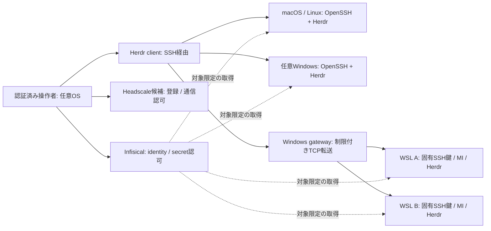

# 分散開発ノードの認証・接続境界

- 状態: 設計承認済み（2026-10-24）。Mac↔Windows専用SSHと、既存Tailscale経由のMac・Windows・WSL workerによる同一Mac Herdr named session/pane共有は歴史的PoCとして確認したが、Mac依存なのでNode Independenceの完成証拠ではない。2026-10-29に既存Infisical VPSへ専用unprivileged Herdr user/sessionを置き、Macからのremote attachとdetach後の稼働を確認。Windows/WSLからのVPS共有session接続は未検証。Headscale現行版のTailworm対策、複数Headscale peer通信、Infisical MI、node lifecycle、低権限Windows worker、本登録・WSL再生成は継続検証。[VPS-hosted Herdr記録](../research/herdr-independent-host-2026-10-29.md)
- 日付: 2026-10-24
- 実装追跡: https://github.com/rebuildup/dotfiles/issues/74
- 関連: [調査と実機証拠](../research/distributed-nodes-2026-10-24.md)、[段階的実装計画](../distributed-nodes.md)

## 目的と完成条件

macOS、Windows、WSL、Linuxを交換可能な開発ノードとして参加・破棄・再生成できること。特定Macを管理親機にしない。認証情報は既存self-hosted Infisical、通信認可はネットワーク制御層、遠隔実行はHerdr公式multi-machineに分担する。

## 提案する構成

Headscale + Tailscaleを第一候補とし、採用確定は対応版・実機PoC後とする。既存tailnetで行う到達性検証はHeadscale検証の代替にはならない。既存VPNのlogin-serverを無断変更しない。Headscale管理権限を全ノードに配らない。独自常駐サーバー・独自scheduler・全体共有秘密鍵は追加しない。

WindowsとWSLのVPN二重実行は既定にしない。まずWindows gateway方式を検証する。gatewayは入れ替え可能な接続属性であり、WSLの認証主体・親ノードではない。ただし実行中WSLがその物理Windowsの停止に依存することは避けられない。

新規WSLのcoding agentは、ユーザーの選択により、そのWSL内で個別にCodexへログインする。controllerのlogin cacheをworkerへコピーしない。将来API資格情報を使う場合は、対象workerに承認したInfisical境界を別途定義する。現在のcontroller認証やOS登録成功からworkerへのsecretアクセス権を導出しない。

2026-10-25、ユーザーは新規workerをOS権限でも分離することを選択した。新規WSL workerごとに専用の標準Windowsアカウントを用意し、既存管理ユーザーのUbuntuを低権限workerへ転用しない。同一Windowsユーザー配下の別ディストリビューションだけでは管理鍵や他workerからの分離を保証しない。Windows SIDは資源所有者の属性であり、論理IDではない。pc-setupがアカウント・profile・WSL・ACLを所有し、秘密情報の承認と配送はInfisical統合側が扱う。管理者の環境変数や認証cacheを子プロセスへ継承しない。

既存Ubuntuを変更せず、新しい標準ユーザーから管理鍵・別worker領域の読取拒否と環境分離を実測する。実装は[pc-setup #134](https://github.com/rebuildup/pc-setup/issues/134)、観測は[VPS・WSL準備記録](../research/distributed-nodes-preparation-2026-10-25.md)で追跡する。管理ホストの管理者は信頼境界の外側に残る。ホスト管理者からの隔離まで必要なら別ホスト等の追加境界が必要となる。

## identityとcanonical ownership

| 項目 | 意味・所有者 |
| --- | --- |
| logical ID | 承認済み論理ノードのUUID。別環境への引継ぎは明示承認する |
| display name | 人間用名。`win-uuu`、`wsl`、`win-lab`は区分例であり接続先ではない |
| instance ID | 新規生成ごとのUUID。コピー・OS machine-id・hostname・IPから導出しない |
| inventory | 管理者レビュー付きGit上の非秘密desired state。現repoに新サービスは作らない |
| machine-local state | instance ID、専用秘密鍵、取得token。`home/`とGitの外へ保存 |
| role / owner / registeredAt | 管理者承認の属性。自己申告で認可しない |
| OS / runtime / capabilities | 観測時刻付き実測属性。secret認可の根拠にしない |
| persistence | `persistent` / `ephemeral`。管理者が承認する |
| VPN ID / address / gateway / SSH endpoint | network側identityと接続属性。論理identityから分離 |
| SSH fingerprint | 操作者の別経路確認後に承認したhost key。専用known_hostsへpin |
| Infisical MI ID | instanceごとに一つ。roleで許可範囲を束ね、認証主体は共有しない |
| Herdr profile ID / session | クライアントごとの接続参照。Herdr CLIが所有。catalogを直接編集しない。画面共有では全clientを同一server/sessionへremote attachする |
| observed status | timestamp、probe元、理由コード付き一時観測。Gitのdesired stateと混同しない |

最小inventoryにはこれらを持たせるが、秘密値・token・session credentialを入れない。Herdr profile IDは全クライアント共通IDではない。各クライアントはinventoryを読んで自分のcatalogへCLI経由で同期する。これは接続先を各clientへ登録するだけで、terminal screen、pane、workspace、agent sessionを同期しない。同一画面を複数端末で扱う要件では、一つのHerdr server/sessionを共有ホストとして選び、各clientがその同じserver/sessionへ公式remote接続する。自動発見は到達性の候補を提示するだけで参加承認には使わない。

## Bootstrapと承認境界

1. pc-setupでOS別のmise / VPN / OpenSSH / Herdr / agent runtimeを導入する。
2. 対象環境内で専用SSH鍵とinstance IDを生成する。秘密鍵はその環境に残す。
3. 初回joinには認証済み人間の承認、または対象・role・期限・一回使用を外部から拘束した資格情報を要求する。未認証端末から資格情報の自動発行はしない。
4. 管理側でroleを確定してinstance別MIと短期単回VPN登録鍵を発行する。VPN用発行権限そのものは対象ノードへ送らない。
5. VPN登録、SSH公開鍵承認とhost key照合、専用接続定義を順に設定する。
6. 専用named Herdr sessionを起動し、各クライアントが公式machine addで登録する。
7. SSH、MI権限、Herdr到達性を独立検査し、必要条件が揃った場合だけactiveにする。

初期PoCのSSHは今回専用の鍵と接続定義を使用する。既存管理用鍵を流用しない。WindowsにSSHがない場合、初回のOS機能有効化はWindows上で必要になる。Windowsに到達する認証経路がない状態でMacから自動実行できるとは扱わない。

汎用WSLにはplatform OIDCを仮定しない。Universal Authを使う場合、bootstrap client secretのTTL/最大使用回数と発行access tokenのTTLを別に設定し、実際の版で再使用拒否を確認する。一回loginだけでは永続ノードの再認証を解決しない。継続認証方式はplatform identity、または承認付き再発行を比較して実機で確定する。管理側の任意マシンでCLIを実行できる形を優先し、独自発行daemonは作らない。

既存dotfiles project bindingは変更しない。`https://secrets.rebuildup.dev`、project `d4c2fc09-a923-4a38-9cf4-b51769aadb76`、`dev`を明示する。ノード用secretを既存projectに置く場合も、最小role/path境界の拒否試験を先に行う。専用projectを選ぶなら別の明示bindingを追加し、未確定IDを捏造しない。

## 認可と秘密情報

2026-10-26のHerdr相互接続PoCは、ユーザーが明示依頼した新規の名前付きsessionと、そのためのmachine profileだけを外部controllerから操作する。Herdr同梱Skillの`HERDR_ENV=1`前提と、外部からfocused sessionを操作しない規則に対し、この専用bootstrap/検証scopeをユーザー指示に基づく限定的overrideとして扱う。`HERDR_ENV`を偽装せず、既存default/focused session・既存workspace・無関係なcatalog entryは操作しない。pane内ではHerdrが実際に注入したcontextを観測してから次の検査へ進む。通常運用へ一般化する場合は、Herdr内の実agentか同等の明示scopeを持つwrapperで制約を維持する。

Herdr0.9.5のremote APIはSSH stdio bridgeを使うため、SSH TCP/agent forwardingの禁止を維持できる。新規named serverの起動前にglobal plugin/hookがないことを確認し、専用の非秘密configをprocess-scopedで指定する。既存catalogを共有する場合は今回所有するprofileだけを公式CLIで追加し、他entryを変更しない。Windows0.9.3では管理者serverと通常権限clientの分離を保証できないため、このPoCは対応する公式0.9.5完全packageをside-by-sideで使用し、`allow_unelevated_clients`を緩和しない。

- ネットワークは初期deny-allから、controller role→対象instanceのSSH port等だけを許可する。WSL gatewayではport別認可とWSL sshd別認可を併用する。
- gateway配下WSLの通信はVPN上で同一source identityになり得る。WSL同士の完全なnetwork identity分離を主張しない。source分離が必須のroleは専用VPNまたは別実行境界の追加検証まで参加させない。
- SSHは汎用OpenSSHを共通基盤にする。ノード固有のhost keyと操作者/用途別のuser keyを分け、agent forwardingを既定無効にする。
- `StrictHostKeyChecking=yes`と専用known_hostsを使う。TOFU、`accept-new`、host key警告の無視で再生成を処理しない。
- MIはinstance別、secret範囲はrole別。join権限とagent実行用secret権限を分ける。既存with-secretsによるproject全体注入を無条件に再利用しない。
- agent taskのsecretは対象ノードの許可範囲でprocess-scoped取得する。操作者の全環境、Herdr prompt、workspace env、ログへsecretをコピーしない。
- SSH証明書は実サーバー版・license確認後の任意比較対象。有料PAMは必須にしない。Infisical secret access監査はlicenseを確認するまで未達要件として残す。

## ライフサイクルと失敗時の処理

`new → enrolling → active → offline → retired`。offlineはheartbeatだけで即認可撤回を意味しない。retiredは終端であり旧instanceの再joinは拒否する。

joinはinstance IDをidempotency keyにする。同じinstance・同じ承認内容なら続行し、名前一致だけではMIやroleを再利用しない。並行joinと同名衝突はinventory更新の競合として拒否し、管理者に選択させる。部分成功は段階別結果を記録して再試行する。ローカルmarkerだけで外部登録成功とみなさない。

再生成では新instance ID・新鍵・新MIを発行する。以前の表示名/論理IDの引継ぎ前に旧instanceの失効を確認し、管理者が承認する。SSH host key pinと各クライアントのHerdr参照を新instanceへ更新する。旧host keyを無条件削除しない。

leaveはMI/発行済token、SSH認可、Herdr接続と、対象が専有するnetwork資源をそれぞれ撤回する。VPN peerはinstance専有か共有gateway参照かをinventoryで区別する。WSL一台のleaveでは共有WindowsのVPN peerを削除せず、そのWSL専用の転送/port許可/SSH認可だけを撤回する。他のWSLの到達性が維持されることをnegative testと対で確認する。専有peerの場合だけpeer/登録鍵を削除する。Herdr machine removeだけでは失効完了ではない。未到達・provider停止・token撤回未確認はpendingで残す。中央側の遮断を先行できても、remote authorized_keys残存と既存SSH/agent processの終了状況は別に記録する。全条件の証拠がない場合、完全失効とは表示しない。

## 障害と運用コスト

2026-10-24、ユーザーはHeadscale実機PoCの配置先として既存Infisical用VPSへの同居を選択した。新規VMの追加課金は行わない。管理SSH接続・既存reverse proxy/使用port・容量・backupを確認してから配置し、Infisicalの既存構成を無断置換しない。

共有gateway自体のleaveは、依存WSLが存在する場合は拒否する。各WSLの接続先移行または明示retireを確認してからgateway資源を撤回し、名前一致だけで依存先を付け替えない。

Headscaleは公開HTTPSと状態DB、backup/更新の継続運用が必要。DERPを使う場合はその公開到達性も必要。ノード間直結とrelayの性能を分けて測る。Headscale停止中も既存peer通信が続き得るため即時失効の保証はできない。

Infisicalとの同一VM配置は追加VM費用を抑えられるが、登録・secret取得・認可変更・同居relayを同時に失う。別containerはVM障害を分離しない。最初は既存VMの容量・backup・公開port・管理権限を確認してから同居可否を決める。独立relay/制御面分離は実測した可用性要求と費用で再評価する。

Infisical停止中は新規join/token更新/新規secret取得を拒否する。ただし実行中processの注入済secret、既発行SSH資格情報、VPN通信が即座に消えるわけではない。復旧後の失効再調停をverifyする。

## 採用までの保留事項

2026-10-24の実機org planでは`rbac=false`、`secretsFolderRbac=false`、`auditLogs=false`を観測した。このinstanceの登録PoCでは細粒度path/custom-role認可を前提にせず、専用projectとbuilt-in roleによる分離を検証する。既存dotfiles projectへノード用の包括的readerを付与しない。監査ログ要件は未達であり、ライセンス変更や接続ログによる代替を暗黙に決めない。

[隔離project/MIでの実機検証](../research/infisical-node-enrollment-poc-2026-10-24.md)では、project境界・一回資格情報の再使用拒否・Identity削除後のtoken/未使用資格情報拒否が成立した。一方、membership削除後はmetadataから消えても発行済tokenの読取が直後に継続した。retireはmembership削除だけで完了させず、instance専有MIと資格情報の撤回・実際の拒否を確認する。viewerはproject全体の権限であり、許可されない環境のデータを同じprojectに混在させない。

実際の接続PoC、Headscale配置先と版、Infisical server/licenseと権限拒否/監査、継続認証、gateway経由で必要なsource分離、実機の失効反映時間を確定する。これらを未確認のまま安全なjoin/leave実装が完成したとは扱わない。

## 2026-10-26時点の到達点

[旧Herdr相互接続PoC記録](../research/herdr-bidirectional-poc-2026-10-26.md)と[2026-10-27再開記録](../research/devnode-resume-2026-10-27.md)にあるMac発の成功主張は、ユーザーの指摘を受け撤回した。2026-10-29の独立再試験ではMac→Windowsのpane nonce往復、Mac→WSLのpane nonce往復とWSL上Codexのassistant応答を確認した。WSL→Macも実際のWSL Herdr paneからMac paneのnonceを読み戻した。証跡と制約は[再検証記録](../research/herdr-mac-e2e-2026-10-29.md)。Windows agent操作、低権限worker隔離、Headscale経由は未検証。

[Headscale登録PoC](../research/headscale-enrollment-poc-2026-10-25.md)では既存GUIと独立したMac userspace clientの登録と、一回用資格情報の期限前再利用拒否・撤去を確認した。peer間通信とrole policy・MTU・障害時挙動は未検証。登録資格情報を撤去しても既存nodeは残るため、node retirementとは区別する。

[Windows worker準備](../research/windows-worker-enrollment-2026-10-25.md)は標準account/profile作成まで進んだ。複数user間の拒否、WSL import/再登録、worker MI/Herdrは未検証。これらを完了させるまで共通join/leaveと再生成の完成を主張しない。

## Git同期と表示名の具現化（2026-10-26）

承認済みinventory/公式Herdr CLI同期の最小実装として、非秘密の表示名desired stateをGit管理し、各端末の接続bindingはmachine-localに保持する。これは接続設定の参照であり、論理node UUID・instance UUID・認可registryの代替ではない。Herdr profile ID/SSH alias/sessionはclient固有のbindingへ置く。Gitから他端末のprivate key/known_hosts/資格情報/session/cacheをコピーしない。

`devnode update check|apply --repo <checkout> --branch <branch>`はcanonical dotfiles originと明示branchを確認し、fetch後の差分とcommitを表示する。applyはclean checkoutかつ同じbranchのfast-forwardだけを許可する。reset/clean/stash/強制checkout、無人push配信、tool installationはしない。未merge PoCではbranch74を明示、将来release済みbranchへ切替える。新しいcheckoutの初回取得とOS prerequisite/service化はpc-setupが所有する。

`devnode machines plan|apply|status`は非秘密desired nameとmachine-local bindingを使う。planは変更予定だけを表示し、applyは期待profile ID・SSH target・remote session・現在labelが一致する登録だけをofficial `machine rename`で更新する。未知profileを採用せず、重複名・binding driftを拒否する。新規接続登録は別途SSH pin/nonceとofficial machine addを確認後、明示bindingする。既存Ubuntu/Ubuntu2の実体を確認せずrename/removeしない。

初期表示は`UUU · Windows`と`Mac · macOS`。新規WSLは物理hostと独立したworker名を併記する。表示変更でinstanceや権限を引き継がない。runtime configやOS常駐化は、それぞれのownerであるuser-level config/pc-setup側で扱い、単なるGit update成功を再起動後の稼働証拠にはしない。
